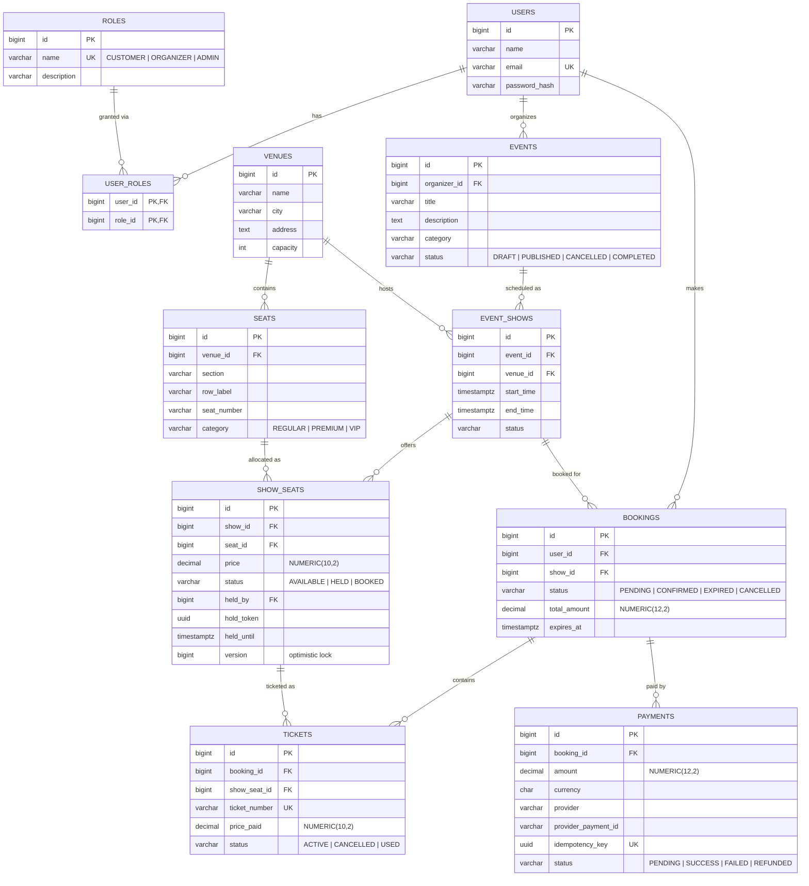
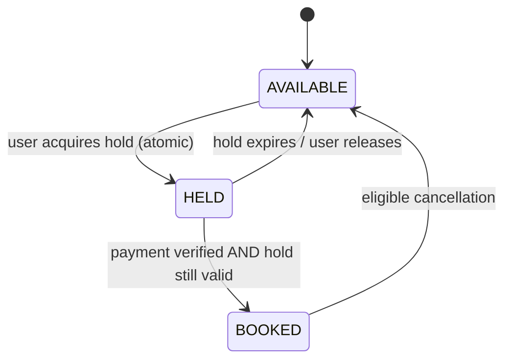
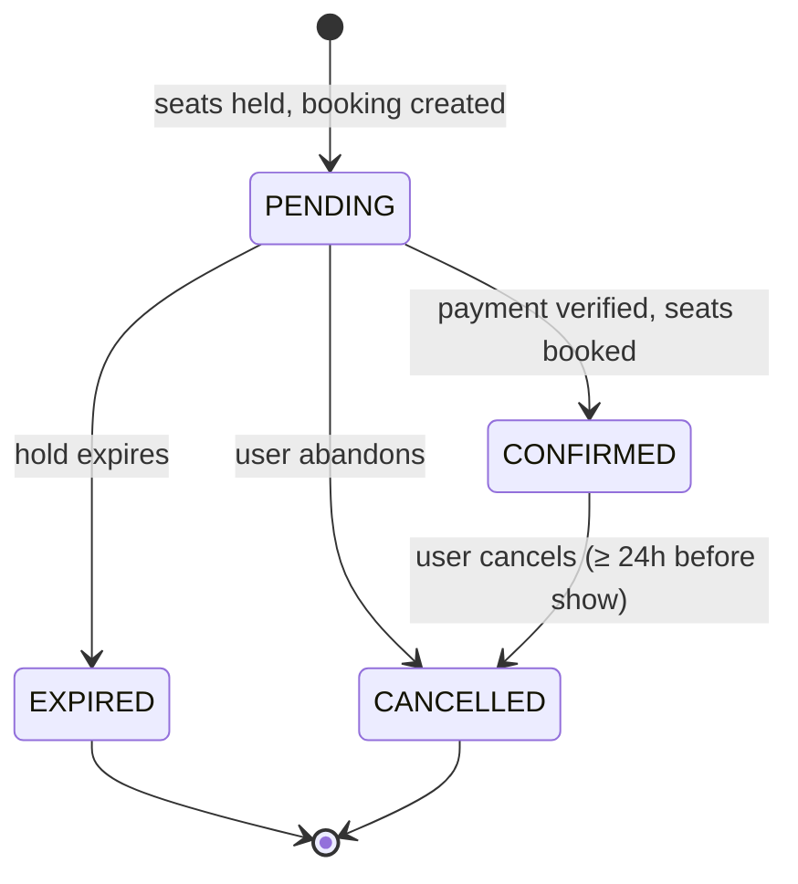

# Ticket Booking API

A backend for booking seats at live events (concerts, sports, comedy, theatre, conferences), built with **Spring Boot**, **PostgreSQL** and **Flyway**.

The central problem is correctness under concurrency: **a seat must never be sold twice**, even when many users try to book the last seat at the same moment, payments arrive late, or background jobs haven't run yet. Most of the design decisions below follow from that requirement.

> **Status:** Work in progress. The full database schema is in place; the Venue API is implemented and tested. See [Roadmap](#roadmap).

---

## Contents

- [Tech stack](#tech-stack)
- [Running locally](#running-locally)
- [Scope](#scope)
- [Architecture](#architecture)
- [Data model](#data-model)
- [State machines](#state-machines)
- [Design decisions](#design-decisions)
- [Known trade-offs and open questions](#known-trade-offs-and-open-questions)
- [Testing strategy](#testing-strategy)
- [API](#api)
- [Roadmap](#roadmap)

---

## Tech stack

| Concern        | Choice                                              |
|----------------|-----------------------------------------------------|
| Language       | Java 21                                             |
| Framework      | Spring Boot 4 (Web MVC, Data JPA, Validation)       |
| Database       | PostgreSQL 17                                       |
| Migrations     | Flyway (schema written by hand, Hibernate only validates it) |
| Testing        | JUnit 5, Mockito, MockMvc, Testcontainers           |
| Build          | Maven                                               |
| Local infra    | Docker Compose                                      |

## Running locally

Prerequisites: Java 21 and Docker.

```bash
# start PostgreSQL
docker compose up -d

# run the application (Flyway applies migrations on startup)
./mvnw spring-boot:run

# run all tests (Testcontainers starts its own PostgreSQL)
./mvnw test
```

Database credentials can be overridden with `DB_USERNAME` and `DB_PASSWORD`.

---

## Scope

### Roles

| Role          | Can do                                                                 |
|---------------|------------------------------------------------------------------------|
| **Customer**  | Register, log in, browse and search events, hold seats, book, cancel, view own bookings |
| **Organizer** | Create and manage their own events and shows, view bookings and revenue for them |
| **Admin**     | Manage users; read access to everything                                |

### In scope for v1

- Search events by city, date and category, with pagination
- View seat availability for a show
- Hold seats for 10 minutes, then confirm with a (simulated) payment
- Cancel a booking up to 24 hours before the show
- Automatic release of expired holds
- JWT authentication and role-based authorization; organizers can only modify their own events

### Out of scope for v1

Real payment gateway, frontend, email/SMS delivery, microservices, mobile app, and **organizer-initiated cancellation of a whole show** (mass refunds). These are deliberate exclusions, not oversights.

---

## Architecture

A **modular monolith**, packaged **by feature** rather than by layer. Each feature owns its controller, service, domain rules and persistence:

```
com.ticketbooking.ticket_booking_api
├── venue
│   ├── api            # controllers, request/response DTOs
│   ├── application    # services, transaction boundaries
│   ├── domain         # business exceptions and rules
│   └── persistence    # JPA entities, repositories
├── event              # (planned)
├── booking            # (planned)
├── user               # (planned)
└── shared
    ├── config         # JPA auditing, etc.
    └── exception      # global error handling (RFC 7807 ProblemDetail)
```

**Why a monolith:** one deployable, one database, and real ACID transactions across seats, bookings and payments. Splitting these into services would turn a single database transaction into a distributed-consistency problem with no benefit at this scale. Feature packaging keeps the boundaries clean, so a module could be extracted later if there were a reason to.

---

## Data model



Every table also has `created_at` and `updated_at` (`TIMESTAMPTZ`). The full schema, with every constraint, is in [`V1__init_schema.sql`](src/main/resources/db/migration/V1__init_schema.sql).

### Entities at a glance

| Entity        | Meaning |
|---------------|---------|
| `Venue`       | A physical place with a fixed seat layout |
| `Seat`        | A physical seat in a venue (section, row, number). Exists once, reused by every show |
| `Event`       | What is being performed (e.g. a concert tour), owned by an organizer |
| `EventShow`   | One occurrence of an event at a venue and time. One event can have many shows |
| `ShowSeat`    | A specific seat **for a specific show**: holds its price and availability |
| `Booking`     | A customer's order for one show; can cover several seats |
| `Ticket`      | One seat within a booking, with the price actually paid |
| `Payment`     | A payment attempt against a booking. A booking can have several attempts |

### Database constraints (defense in depth)

Application code has bugs; the database is the last line of defense. These rules are enforced in PostgreSQL, not only in Java:

| Constraint | Protects against |
|------------|------------------|
| `UNIQUE (users.email)` | Duplicate accounts |
| `UNIQUE (venue_id, section, row_label, seat_number)` | The same physical seat defined twice |
| `UNIQUE (show_id, seat_id)` on `show_seats` | A seat appearing twice in one show |
| Partial unique index on `tickets(show_seat_id) WHERE status IN ('ACTIVE','USED')` | **Double booking.** A seat can have many tickets over time (booked, cancelled, rebooked), but only one live ticket at a time |
| `CHECK chk_show_seat_hold` | Hold fields are all-or-nothing: a `HELD` seat must have an owner, token and expiry; any other status must have none |
| `CHECK (status <> 'PENDING' OR expires_at IS NOT NULL)` on `bookings` | A pending booking without an expiry, which would hold seats forever |
| `CHECK (end_time > start_time)` on `event_shows` | Impossible show times |
| `UNIQUE (idempotency_key)` and partial unique on `(provider, provider_payment_id)` | Processing the same payment twice |
| `CHECK` on every status and category column | Invalid enum values written by bypassing the application |
| `CHECK (LENGTH(TRIM(...)) > 0)` on names | Blank strings that pass `NOT NULL` |

---

## State machines

### ShowSeat



### Booking



### Rules that span both machines

1. **Expiry is checked at confirmation time, inside the transaction.** The background expiry job is cleanup, not the source of correctness. If the job is late or down, a booking whose `expires_at` has passed still cannot be confirmed.
2. **Payment callbacks are idempotent.** A repeated callback for the same payment is recognised by its unique provider ID / idempotency key and has no further effect.
3. **Cancellation is one transaction:** booking → `CANCELLED`, its tickets → `CANCELLED`, their show seats → `AVAILABLE`, payment → refunded. Either all of it happens or none of it does.
4. **Hold writes are atomic with the booking:** `show_seats.held_until` and `bookings.expires_at` are always written in the same transaction with the same value (see [trade-offs](#known-trade-offs-and-open-questions)).

---

## Design decisions

### 1. Separate `Seat` from `ShowSeat`
**Decision:** A `Seat` is the physical chair; a `ShowSeat` is that chair for one show.
**Why:** The same seat is sold again for every show. Putting availability on `Seat` would mean a seat booked for Friday is also unavailable on Saturday. Availability and price are properties of *the seat at a show*, not of the seat.

### 2. Separate `Event` from `EventShow`
**Decision:** An event (e.g. a tour) can have many shows at different venues and times.
**Why:** Avoids duplicating title, description and organizer for every date, and matches how people search ("show me dates for this event").

### 3. Price snapshot on `Ticket`
**Decision:** `tickets.price_paid` is copied from the show seat at booking time.
**Why:** If an organizer later changes prices, historical bookings, revenue reports and refunds must still reflect what the customer actually paid.

### 4. Optimistic locking on `ShowSeat`
**Decision:** `show_seats.version`, mapped to JPA `@Version`.
**Why:** Most seats are never contested, so taking a database lock on every read is wasteful. When two users race for the same seat, the second update fails on a stale version and gets a clear "seat no longer available" error instead of silently overwriting. Pessimistic locking (`SELECT ... FOR UPDATE`) remains an option for hot spots and will be compared in the concurrency tests.

### 5. Holds expire by time, not only by a job
**Decision:** A hold carries an expiry timestamp, and every confirmation checks it against `now()` in the same transaction.
**Why:** Correctness must not depend on a scheduler being on time. The expiry job only frees seats so they show as available sooner.

### 6. Roles as a many-to-many table
**Decision:** `users` ↔ `roles` via `user_roles`, rather than a single `role` column.
**Why:** A user can be both a customer and an organizer. Trade-off: one extra join on login, which is negligible.

### 7. Schema owned by Flyway, not Hibernate
**Decision:** SQL migrations are written by hand; `spring.jpa.hibernate.ddl-auto=validate`.
**Why:** Constraints like partial unique indexes and CHECKs can't be expressed reliably through JPA annotations, and auto-generated schemas change silently. With `validate`, the app refuses to start if entities and schema disagree. Applied migrations are never edited; changes go in new `V2__`, `V3__` files.

### 8. Money as `NUMERIC` / `BigDecimal`, time as `TIMESTAMPTZ` / `Instant`
**Why:** Floating-point types can't represent amounts like 0.10 exactly. `TIMESTAMPTZ` stores an absolute instant, so users and servers in different time zones always agree on when a hold expires or a show starts.

### 9. Statuses as `VARCHAR` + `CHECK`, mapped to Java enums
**Decision:** `@Enumerated(EnumType.STRING)` in Java, a `CHECK (status IN (...))` in SQL.
**Why:** Readable in the database, safe to reorder in Java (unlike ordinal mapping), and the database still rejects invalid values. Native PostgreSQL enums were avoided because altering them is awkward in migrations.

### 10. Payments are attempts, not a single field on Booking
**Decision:** A booking has many `payments` rows.
**Why:** A failed payment can be retried before the hold expires, and every attempt is kept for auditing.

### 11. Consistent errors with RFC 7807 `ProblemDetail`
**Decision:** A global `@RestControllerAdvice` returns `application/problem+json` for validation errors (with per-field messages), not-found (404) and conflicts (409).
**Why:** Clients get one predictable error format, and internal exceptions never leak to the response.

### 12. `open-in-view` disabled
**Why:** Keeps database access inside service-layer transactions and prevents lazy-loading queries from firing during JSON serialization, which hides N+1 problems.

---

## Known trade-offs and open questions

Things I've consciously chosen, and things still to decide.

- **Hold stored on `ShowSeat` and expiry on `Booking`.** `show_seats.held_until` and `bookings.expires_at` represent the same deadline. This is deliberate denormalisation, so seat availability can be read without a join, with the rule that both are always written in the same transaction. The alternative is `show_seats.held_by_booking_id` pointing at the booking as the single source of truth.
- **Price on every `ShowSeat`.** Creating a show at a 5,000-seat venue inserts 5,000 rows. It keeps availability queries simple and allows per-seat pricing. The alternative is a `show_category_price` table.
- **`venues.capacity` is derived data.** It should equal the number of seats. *To decide:* compute it from seats, or validate seat count ≤ capacity when seats are added.
- **Late payment (planned, `V2` migration).** A payment callback can arrive after the booking has expired and its seats have been released, maybe to someone else. The booking stays `EXPIRED`, and the payment moves to a new `REFUND_PENDING` status to be refunded automatically.
- **Overlapping shows at a venue (planned, `V2` migration).** Currently checked in the service layer only. Planned: a PostgreSQL exclusion constraint on `(venue_id, tstzrange(start_time, end_time))` using `btree_gist`, so concurrent requests can't create overlapping shows.
- **Bulk updates skip JPA auditing.** `updated_at` is set by Spring Data auditing, which doesn't run for `@Modifying` bulk queries (like the expiry job), so those queries set `updated_at = now()` explicitly.

---

## Testing strategy

| Level | Tooling | What it proves |
|-------|---------|----------------|
| Unit | JUnit 5, Mockito | Service logic in isolation |
| Web slice | `@WebMvcTest`, MockMvc | Request validation, status codes, headers and error format, with the service mocked |
| Integration | `@SpringBootTest`, Testcontainers PostgreSQL | Migrations apply cleanly, entities match the schema, and database constraints behave as designed |
| Concurrency (planned) | Testcontainers, `ExecutorService` | Many threads booking the same seat at once produce exactly one booking |

Integration tests run against real PostgreSQL rather than H2 because the design depends on PostgreSQL-specific features (partial indexes, CHECK constraints, `TIMESTAMPTZ`, exclusion constraints).

---

## API

Base path: `/api/v1`

| Method | Path | Description | Status |
|--------|------|-------------|--------|
| `POST` | `/venues` | Create a venue | ✅ Done |
| `GET`  | `/venues/{id}` | Get a venue | ✅ Done |
| `POST` | `/venues/{id}/seats` | Add seats to a venue (bulk) | 🚧 In progress |
| `GET`  | `/venues/{id}/seats` | List a venue's seats | 🚧 In progress |

Interactive OpenAPI documentation is planned (week 7).

---

## Roadmap

- [x] Data model, state machines and schema
- [x] Project setup, Flyway migration, Docker Compose
- [x] Venue API with validation and global error handling
- [ ] Seat API and Testcontainers integration tests
- [ ] Spring Security with JWT, roles, organizer ownership checks
- [ ] Seat holds, booking, expiry job, concurrency tests
- [ ] Caching event listings (Redis), pagination, OpenAPI docs
- [ ] GitHub Actions CI, containerised app, architecture diagram
